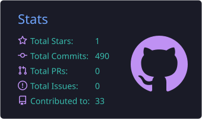

<h1 align="center">Hi, I'm nuhregaibunsal 👋</h1>

  <b>Backend & full-stack developer</b> — Java / Spring Boot, event-driven systems, data pipelines and a bit of computer vision.

  

### 🚀 Featured projects

| Project | What it is | Stack |
|---|---|---|
| [**CryptoPal**](https://github.com/nuhregaibunsal/cryptopal) | Crypto trading platform with live prices, portfolios and an AI market assistant | Spring Boot · React · Redis · PostgreSQL |
| [**VoltWise**](https://github.com/nuhregaibunsal/voltwise) | Real-time IoT energy analytics with LLM-generated saving advice | Spring Boot · Kafka · Ignite · Gemini |
| [**Driftline**](https://github.com/nuhregaibunsal/driftline) | Neon synthwave runner with combat, a boss and mobile controls — [▶ play it](https://nuhregaibunsal.github.io/driftline/) | React Three Fiber · GLSL |
| [**Finger Counter Web**](https://github.com/nuhregaibunsal/finger-counter-web) | Live finger counting from your webcam, plus a bubble-popping game — [▶ try it](https://nuhregaibunsal.github.io/finger-counter-web/) | MediaPipe · TypeScript |
| [**License Plate Reader**](https://github.com/nuhregaibunsal/license-plate-recognition) | Classical ALPR pipeline that detects and reads car plates | OpenCV · EasyOCR |
| [**Keep on Mining Bot**](https://github.com/nuhregaibunsal/keep-on-mining-bot) | Computer-vision game bot with upgrade planner, watchdog and web dashboard | Python · OpenCV · C# |
| [**Books ETL Pipeline**](https://github.com/nuhregaibunsal/books-etl-pipeline) | Scrape → clean → idempotent load into Dockerized PostgreSQL | Python · pandas · Docker |
| [**Makro Stüdyo**](https://github.com/nuhregaibunsal/makro-studyo) | Keyboard + mouse macro recorder with scan-code replay | Python · Win32 |

### 🔭 About me

- 🎓 Built 18 hands-on projects in the **i2i Academy** program, across backend, cloud, data and AI
- ⚙️ Most at home with **Spring Boot**, **Kafka**, **Redis**, **PostgreSQL** and **Docker**
- 📱 Currently building a native **Android (Kotlin + Jetpack Compose)** app
- 🌱 Interested in distributed systems, security and applied ML

### 🛠️ Tech stack

  
  
  
  
  
  
  
  
  
  
  

  

  <picture>
    <source media="(prefers-color-scheme: dark)" srcset="https://raw.githubusercontent.com/nuhregaibunsal/nuhregaibunsal/output/github-snake-dark.svg" />
    
  </picture>

